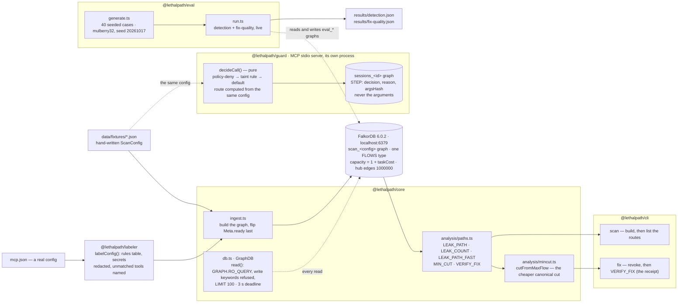

# Architecture

How the six packages fit together, one page. The exact node/relationship shapes
are frozen in [`docs/CONTRACTS.md`](./docs/CONTRACTS.md); the CLI transcripts in
the README are the authoritative demo output.

## Packages

| Package | What it is |
|---|---|
| `@lethalpath/schema` | Types and validation (`validateScanConfig`) — the `ScanConfig` shape every other package agrees on. |
| `@lethalpath/core` | Ingest (config → FalkorDB graph), the analysis queries (`LEAK_PATH`, `LEAK_COUNT`, `LEAK_PATH_FAST`, `MIN_CUT`, `VERIFY_FIX`), the residual min-cut, and the guarded `GraphDB` client. |
| `@lethalpath/labeler` | A rules table that turns a real `mcp.json` into a validated `ScanConfig` — deterministic, no model at runtime. |
| `@lethalpath/cli` | `scan` and `fix` — the two verbs a person types. |
| `@lethalpath/guard` | An MCP stdio server that fronts a live session, decides each tool call, and logs to `sessions_<id>`. |
| `@lethalpath/eval` | The measurement harness: 40 seeded cases per suite against live FalkorDB, writing `results/*.json`. |

## The flow



## The graph model

```
(:Server {id, name, source})-[:HOSTS]->(:Tool)
(:Resource {id, kind, trust?, sensitivity?, visibility?, scope?})
(:Tool {id, name, server, labelSource, labelConf})
(:Context {id:'context'})
(:Meta {id:'scan', config, title, nodes, edges, ready})
```

Every data movement is **one** relationship type — `FLOWS` — because
`algo.maxFlow` on 6.0.2 accepts exactly one:

| movement | capacity |
|---|---|
| tool reads a resource | `1 + taskCost` |
| tool writes a resource | `1 + taskCost` |
| tool fills the context / context feeds a tool | `1000000` (structural) |

`grant` on the edge is the tool name — the permission you would revoke — and
`taskCost` counts the declared tasks that call that tool. The cost model is why
the min-cut prefers the grant that breaks fewer declared tasks: a max-flow
admits two canonical minimum cuts, and the product picks the cheaper one (fewer
grants, fewer broken tasks, write side on a full tie).

## What is load-bearing

- **Multigraph per config, per session.** `scan_<config>` and `sessions_<id>`
  are separate graphs on one instance (`select_graph`). This is tenant
  isolation without extra infrastructure: deleting a run is deleting a graph,
  and no two runs can read each other.
- **`GRAPH.RO_QUERY` as the backstop.** Every read — CLI, analysis, anything
  that answers a question — goes through `GraphDB.read`; the server rejects
  writes on it outright. In front of that sit three application checks
  (write-keyword refusal before dispatch, `LIMIT` capped at 100, a 3 s
  deadline). The checks are convenience; the server-side rejection is the
  guarantee. The only writers besides ingest are the guard's session appends.
- **`(:Meta).ready`.** Set as the last write of ingest and checked before
  analysis, so a scan never reads a half-built graph.
- **`algo.maxFlow` + the residual cut.** The fix is a real minimum cut, not a
  heuristic, and `VERIFY_FIX` re-runs the traversal with `$revoked` excluded —
  a count of 0 is the receipt, and a non-zero remainder exits 1 and says so.
- **The session hash.** The guard's audit graph stores decisions and a 16-hex
  sha256 of the canonical arguments, never the arguments. No file contents, no
  message bodies, no credentials anywhere in either graph — capability labels
  only.
